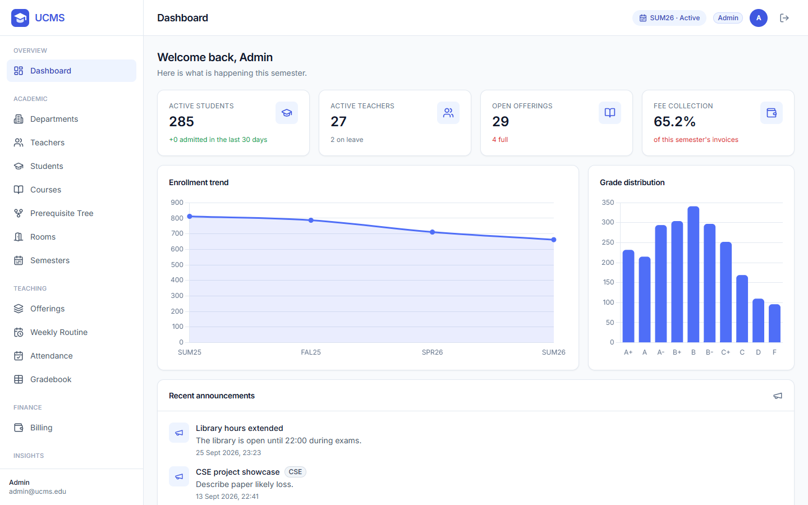
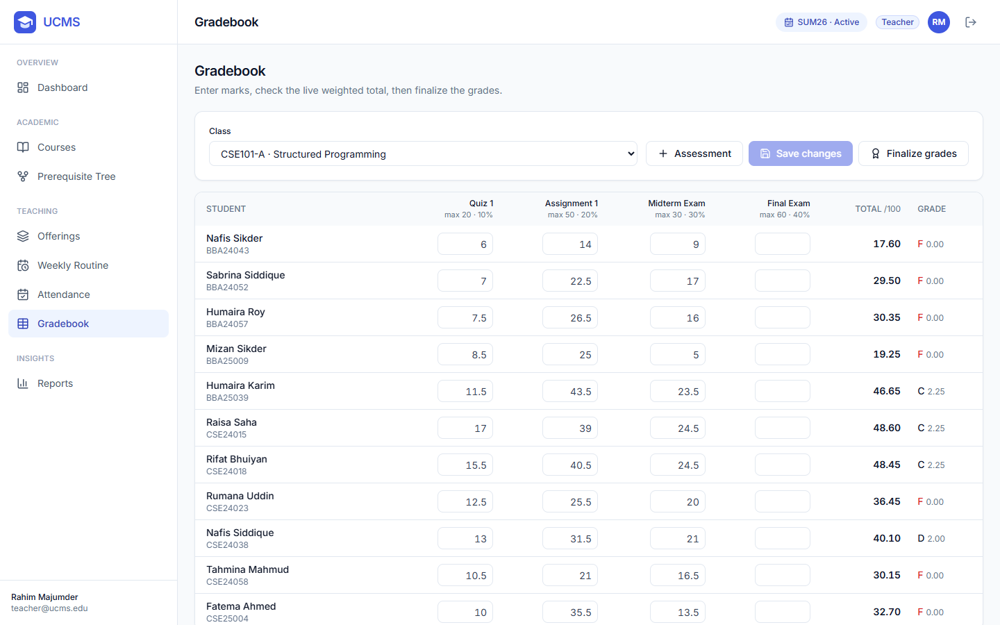
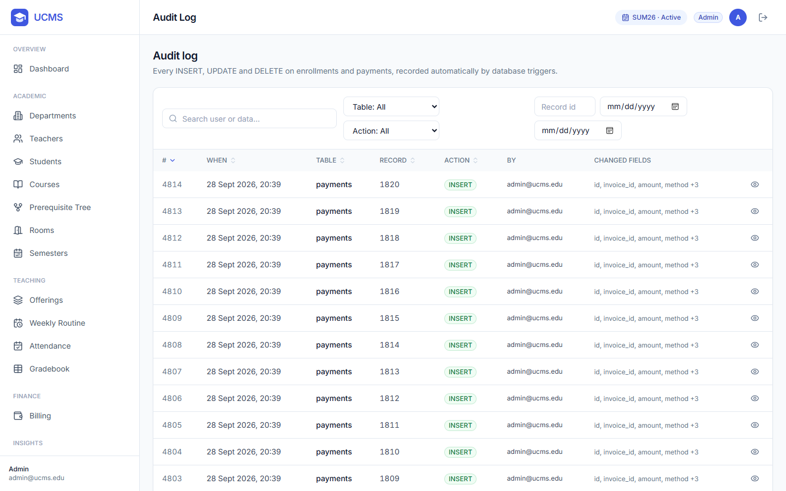
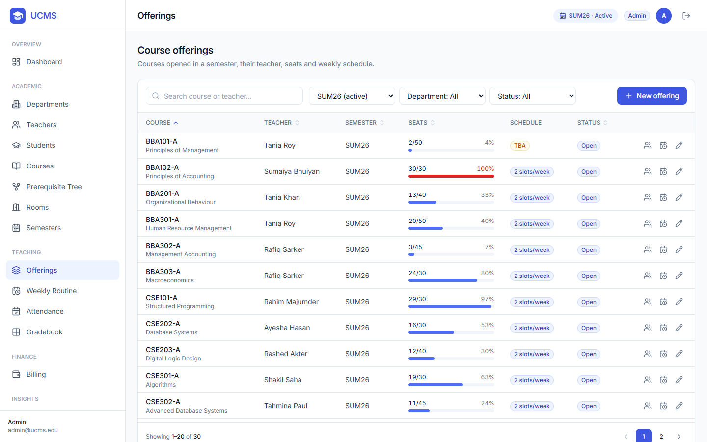
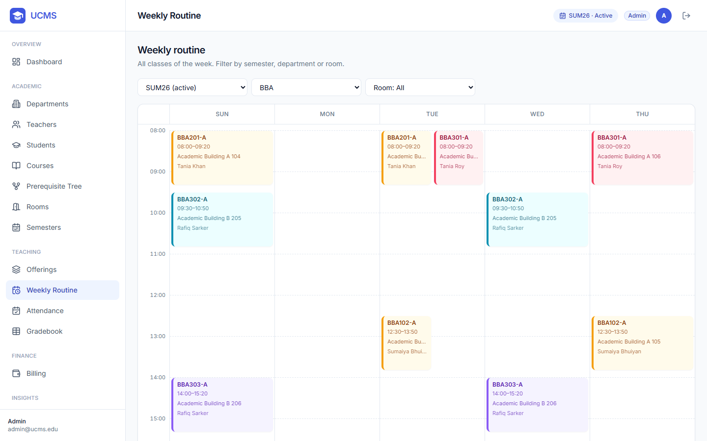
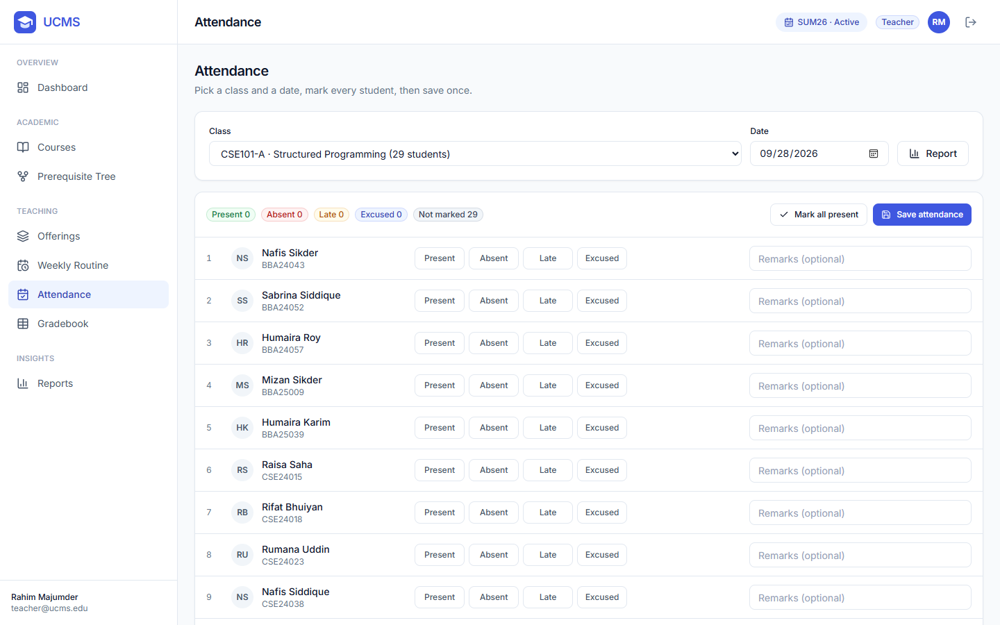
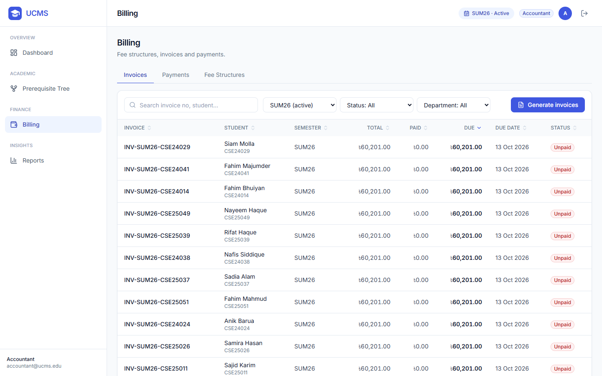
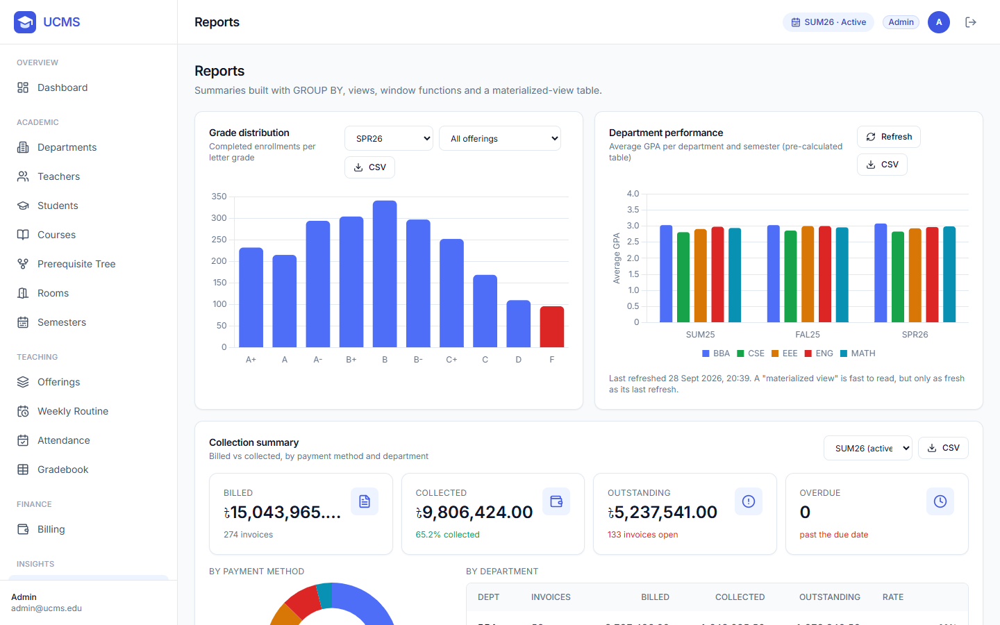
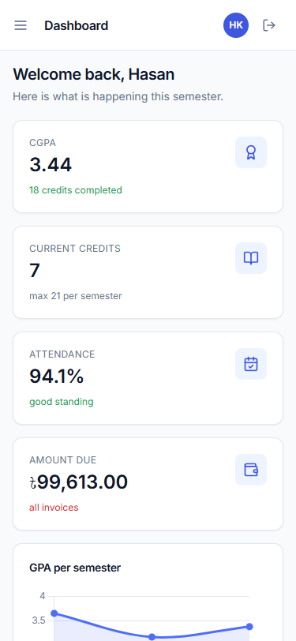
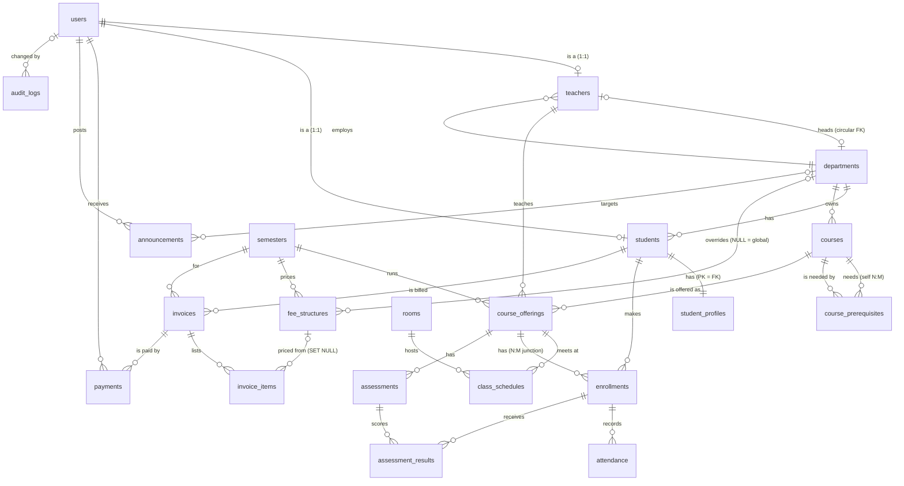

# School ERP: Simple School Management System

**A simple school management platform for grades 1–12:
students, classes, attendance, grading, billing and announcements.
It has role-based portals and a database layer that enforces its own business rules.**




---

## Contents
- [Overview](#overview)
- [Key features](#key-features)
- [Screenshots](#screenshots)
- [Architecture](#architecture)
- [Database design](#database-design)
- [Getting started](#getting-started)
- [Testing](#testing)
- [API overview](#api-overview)
- [Roles and permissions](#roles-and-permissions)
- [Configuration](#configuration)
- [Project structure](#project-structure)
- [Author](#author)
- [License](#license)

---

## Overview

School ERP is built only for ZPPS Mamdapur: administrators manage classes, sections, students,
staff and subjects; teachers take attendance and publish results; accountants manage school fees;
and school staff can publish notices, activities, photos, videos, admission requirements and
scholarship information. An administrator can also update the school's name, logo, tagline and
contact details from School Settings.

The core design choice is that **data integrity lives in the database, not only in the
application code.** Over-full classes, double-booked rooms, marks above the maximum, over-paid
invoices and a second active semester are rejected by SQLite itself, through constraints,
triggers and partial unique indexes. Every change to enrollments and payments is written to an
audit trail by the database. The rules still hold for writes that bypass the API.

| Layer | Technology |
|---|---|
| Database | SQLite 3 in WAL mode, through Python's `sqlite3` driver. Hand-written, parameterized SQL with no ORM. |
| Backend | Python 3.11, FastAPI, Uvicorn, Pydantic v2, JWT authentication (python-jose), bcrypt password hashing |
| Frontend | HTML, vanilla JavaScript, Tailwind CSS, Chart.js, Lucide icons. No build step. |
| Quality | Automated pytest coverage, including multi-threaded race-condition and authentication protection tests |

**At a glance:** 23 normalized tables · 36 triggers · 5 views · 26 indexes · 72 REST endpoints ·
14 responsive school pages · staff-focused role-based access.

---

## Key features

### For each role
- **Admin:** manage classes and sections, staff, students (a 2-step onboarding form), subjects,
  attendance, results, school fees and weekly routine; publish school content and update the
  school's logo, name, tagline and contact details from School Settings.
- **Teacher:** weekly timetable, bulk attendance entry, a gradebook with live weighted totals,
  one-click result finalization, and class attendance management.
- **Accountant:** school fee structures, invoice generation, payment recording (cash, bank,
  bKash, Nagad, card) and collection records.

The visible website intentionally does not expose college-only modules such as semesters,
enrollment, CGPA, GPA, course prerequisites, rooms or academic reports. Legacy database and API
names remain only where needed to preserve existing records and calculations.

Every signed-in user can change their password from the key icon in the top navigation.

---

## Screenshots

| | |
|---|---|
| **School information**. Notices, activities, gallery media, admission requirements and scholarships. | **Teacher: gradebook**. Editable marks with a live weighted total.  |
| **Student record**. Class, section, attendance and progress information. | **Audit log**, written automatically by database triggers.  |
| **Offerings**: seat fill and schedules.  | **Weekly routine**.  |
| **Teacher: attendance**. Bulk save in a single transaction.  | **Accountant: billing**.  |
| **Reports and analytics**.  | **Mobile (375 px)**.  |

---

## Database design

21 normalized core tables, plus two supporting tables: an audit-actor table and the materialized
department-performance view. The only stored derived values (`enrolled_count`, `paid_amount`) are
deliberate, for fast reads. Triggers keep them exact.



| Relationship | Example | Implementation |
|---|---|---|
| One-to-one | user ↔ teacher, user ↔ student | `UNIQUE` foreign key |
| Strict one-to-one | student ↔ profile | primary key doubles as foreign key, `ON DELETE CASCADE` |
| One-to-many | department → courses, invoice → payments | foreign key on the "many" side |
| Many-to-many with attributes | students ↔ offerings | `enrollments` junction (status, marks, grade) |
| Self-referencing many-to-many | course ↔ prerequisite course | `course_prerequisites`, self-reference blocked by `CHECK` |
| Circular | department ↔ head teacher | added with SQLite's table-rebuild procedure, `ON DELETE SET NULL` |

---

## Getting started

**Requirement:** Python 3.11 or newer. SQLite ships with Python.

```bash
git clone https://github.com/kasbe0006/School-Repo-Main.git
cd School-Repo-Main
python -m venv .venv
.venv\Scripts\activate              # Windows
# source .venv/bin/activate         # macOS / Linux
pip install -r requirements.txt
copy .env.example .env              # macOS / Linux: cp .env.example .env

python run.py
```

Open **http://localhost:8000**. The health check is at **/health** and the interactive API documentation (Swagger UI) is at
**http://localhost:8000/docs**.

On first start the database is created empty. Set `PROVISION_ADMIN_EMAIL` and
`PROVISION_ADMIN_PASSWORD` (at least 12 characters) to create the first administrator.
The optional `scripts/seed.py` utility is for automated testing only; do not use it for the
live school database.

### Deploy to Render

This repository includes a Render Blueprint in `render.yaml`. After pushing the project to
GitHub, create a new Blueprint on Render and select the repository. Render will build and start
the web service from that file; its public URL will appear in the Render dashboard. The Blueprint
uses a small persistent disk for SQLite, so the database survives normal restarts and deploys.
This is intended for a small school and single application instance.

Production does not seed demo data. Before the first start, create the administrator in the
deployed environment by setting `PROVISION_ADMIN_EMAIL` and
`PROVISION_ADMIN_PASSWORD` (at least 12 characters). The application creates that one admin
only when the database has no users. Remove those two environment variables after the first
successful deployment. Alternatively, run the command locally against the database:

```bash
python scripts/provision_admin.py admin@your-school.edu
```

Set a real school logo and use HTTPS. Keep regular backups using:

```bash
python scripts/backup_db.py
```

Store generated backup files outside the server as well. Periodically test a restore by copying
a backup to a separate database path and opening the application against that copy.
To restore a verified backup, stop the server first and run:

```bash
python scripts/restore_db.py backups/ucms_YYYYmmdd_HHMMSS.db --yes
```

The restore command verifies SQLite integrity and foreign keys before replacing the configured
database. Keep at least one recent backup outside the hosting provider.

The application adds browser security headers to responses and enables HSTS in production.

### Go-live checklist

Before entering real student data:

1. Set `ENVIRONMENT=production`, `AUTO_SEED=false`, a random `JWT_SECRET`, and the three
   `SCHOOL_*` branding variables.
2. Set `PROVISION_ADMIN_EMAIL` and `PROVISION_ADMIN_PASSWORD` for the first start, then remove
   both variables after the admin logs in and changes the password.
3. Confirm Render uses the persistent `/var/data` disk and `/health` reports `{"status":"ok"}`.
4. Create teacher, accountant, and student accounts; verify each role can access only its
   intended pages and records.
5. Configure the academic session, classes/sections, subjects, grading rules, fee structures,
   and school contact details.
6. Run a complete sample workflow: admission, attendance, assessment, grade finalization,
   invoice, payment, report, backup, and restore.
7. Download a backup outside Render and schedule the same backup process at least daily.
8. Use HTTPS, change all temporary passwords, and have school staff approve the workflow before
   importing real records.

The source code cannot create hosting secrets, configure DNS/HTTPS, schedule off-server backups,
or approve school policy. Those are required deployment actions after the application is built.

### Low-cost Render launch

The included [render.yaml](./render.yaml) is configured for the low-cost Render Starter service
with a persistent 1 GB disk and a free Render-provided subdomain. After creating the service,
set the secret environment variables in the Render dashboard and deploy. Run the preflight check
from the service shell before accepting real data:

```bash
python scripts/check_production.py
```

The free Render plan is not suitable for real records because its filesystem is temporary. The
Starter plan is the minimum safe option here because this application uses SQLite and needs a
persistent disk. The Render subdomain is free; a custom domain is optional later.

The login page does not expose demo accounts. Create all staff and student accounts from the
administrator portal using real school records.

### Bulk student accounts

Admins do not need to enter students one by one. On **Students**, choose **Import CSV**,
download the template, fill one row per student, and upload it. The admin chooses one initial
password for the whole import; every student still has a separate email/login. Give each
student their email and the shared initial password, then require them to change it after
their first login. Imports accept up to 500 students and fail as a whole if any row is invalid.

---

## Testing

```bash
pytest -q
```

**321 tests, all passing**. Each test runs against its own fresh database
file, so the suite is isolated and can run in any order.

| Suite | Tests | Coverage |
|---|---|---|
| `test_constraints.py` | 94 | Every CHECK, UNIQUE and foreign-key rule rejects invalid data; cascade, restrict and set-null behaviour; valid edge cases are still accepted |
| `test_triggers.py` | 29 | Timestamps, seat counters, marks validation, invoice recomputation, audit entries with the correct actor, schedule clashes |
| `test_services.py` | 55 | All 10 business services, including each of the 7 enrollment rejection reasons; a rejected operation leaves the database byte-for-byte unchanged |
| `test_api.py` | 129 | A permission matrix for **every** endpoint (401 / 403 / allowed), record-ownership rules, authentication, end-to-end flows, error formats, SQL-injection-safe sorting, smoke tests on the full demo data |
| `test_concurrency.py` | 9 | Parallel threads racing for the last seat: exactly one wins, every time; locking and isolation behaviour |

The frontend was also verified in a headless browser: all 18 pages for every role, at desktop
and mobile widths, with no script errors or layout overflow, plus 20 end-to-end user flows.

---

## API overview

All endpoints are under `/api` and documented in Swagger UI at `/docs`.

- **Lists:** `?page=1&limit=20&search=&sort=&order=asc` returns
  `{"items": [...], "total": 57, "page": 1, "limit": 20, "pages": 3}`.
- **Errors:** always `{"detail": "message", "errors": {"field": "message"}}`, with status 400 /
  401 / 403 / 404 / 409 / 422.
- **Money:** sent in rupees (`1500.50`), returned as integer paise (`150050`) plus a decimal string
  (`"amount_rupees": "1500.50"`).

| Area | Endpoints |
|---|---|
| Auth | `POST /auth/login`, `GET /auth/me`, `POST /auth/change-password` |
| Dashboard | `GET /dashboard/stats` (role-specific) |
| People | departments, teachers, students: list / create / get / update · `GET /teachers/{id}/workload` · `GET /students/{id}/transcript`, `/dues`, `/attendance` |
| Catalogue | subjects: list / create / get / update |
| Rooms and semesters | list / create / get / update · `GET /semesters/active` · `PATCH /semesters/{id}/activate` · `POST /semesters/{id}/close` |
| Offerings and schedules | list / create / get / update · `GET /offerings/{id}/roster` · `POST /offerings/{id}/schedules` · `DELETE /schedules/{id}` · `GET /schedules/weekly` |
| Class records | `POST /enrollments` · `GET /enrollments` · `PATCH /enrollments/{id}/drop` · `POST /enrollments/{id}/finalize-grade` |
| Attendance and assessments | `POST`/`GET /offerings/{id}/attendance` · `GET /offerings/{id}/attendance-report` · `POST /assessments` · `POST /assessments/{id}/results` · `GET /offerings/{id}/gradebook` |
| Billing | `GET`/`POST /fee-structures` · `POST /invoices/generate` · `GET /invoices`, `/invoices/{id}` · `GET`/`POST /payments` |
| School content and audit | `GET /school-content/public` · `GET`/`POST /school-content` · `DELETE /school-content/{id}` · `GET /audit-logs` |
| Reports | `GET /reports/grade-distribution`, `/department-performance` (+ refresh), `/collection-summary`, `/low-attendance` |

---

## Roles and permissions

| Capability | Admin | Teacher | Student | Accountant |
|---|:-:|:-:|:-:|:-:|
| Manage departments, people, courses, rooms, semesters, offerings | ✔ | | | |
| View timetable, course catalogue, prerequisite tree | ✔ | ✔ | ✔ | ✔ |
| Attendance, marks, grade finalization | ✔ | own classes | | |
| Enroll and drop | ✔ | | self only | |
| Transcript, dues, attendance record | ✔ | | self only | |
| Fee structures, invoices, payments | ✔ | | own invoices (read) | ✔ |
| Reports | ✔ | own classes | | collections |
| Audit log | ✔ | | | |

Access is enforced twice: a **role check** on every endpoint and an **ownership check** on
individual records. So a student gets `403 Forbidden` when asking for another student's
transcript, even though both have the student role.

---

## Configuration

Settings are read from environment variables or from a `.env` file (see `.env.example`).

| Variable | Default | Description |
|---|---|---|
| `UCMS_DB_PATH` | `ucms.db` | Database file location |
| `JWT_SECRET` | `dev-secret-change-me` | Token signing key. Set a long random value in production. |
| `JWT_EXPIRE_HOURS` | `8` | Session length |
| `ENVIRONMENT` | `development` | Runtime mode; production rejects unsafe defaults |
| `AUTO_SEED` | `false` | Keep false for the live school database |
| `LOGIN_MAX_FAILURES` | `5` | Failed attempts allowed per IP/email before temporary blocking |
| `LOGIN_FAILURE_WINDOW_SECONDS` | `300` | Failed-login blocking window |
| `HOST` / `PORT` | `127.0.0.1` / `8000` | Server address |

Production requires a random `JWT_SECRET` of at least 32 characters and
`AUTO_SEED=false`. The production database must already contain a real
administrator account; the application refuses to start with an empty user
table rather than creating demo credentials.

---

## Project structure

```
ucms/
├── run.py                 one-command start: prepares the database, then runs the server
├── requirements.txt       pinned dependencies
├── sql/                   schema: tables, circular-FK rebuild, indexes, views, triggers, materialized view
├── scripts/               init, reset, seed, backup and query-runner utilities
├── queries/               40 analytical SQL queries (CTEs, window functions, reports)
├── app/
│   ├── main.py            FastAPI application
│   ├── database.py        connections, PRAGMAs, transaction management
│   ├── security.py        bcrypt, JWT, role and ownership checks
│   ├── errors.py          uniform error responses
│   ├── pagination.py      shared paging / search / sorting
│   ├── schemas/           Pydantic request models
│   ├── repositories/      data access (SQL)
│   ├── services/          business logic
│   └── routers/           17 routers, 70 endpoints
├── frontend/              18 pages, shared JS component library, styles
├── tests/                 fixtures, data factory and 5 test suites
└── docs/screenshots/      README images
```

---

## Author

**Md Emon Hasan**

- Email: [emon.mlengineer@gmail.com](mailto:emon.mlengineer@gmail.com)
- Portfolio: [Md-Emon-Hasan](https://emonlabs-ai.hitechparks.com/)
- LinkedIn: [md-emon-hasan](https://www.linkedin.com/in/md-emon-hasan-695483237/)
- GitHub: [Md-Emon-Hasan](https://github.com/Md-Emon-Hasan)
- Facebook: [Md-Emon-Hasan](https://www.facebook.com/mdemon.hasan2001/)
- WhatsApp: [+8801834363533](https://wa.me/8801834363533)

---

## License

MIT License - see [LICENSE](LICENSE) file for details.

---
